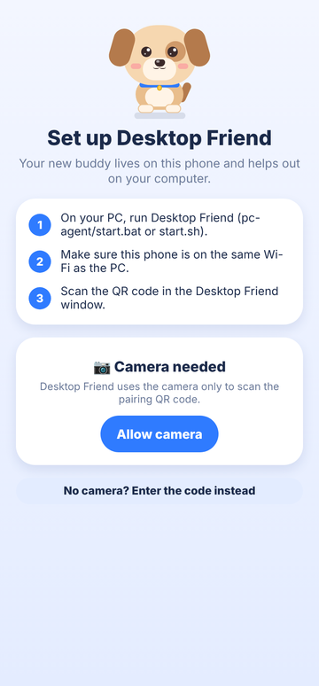
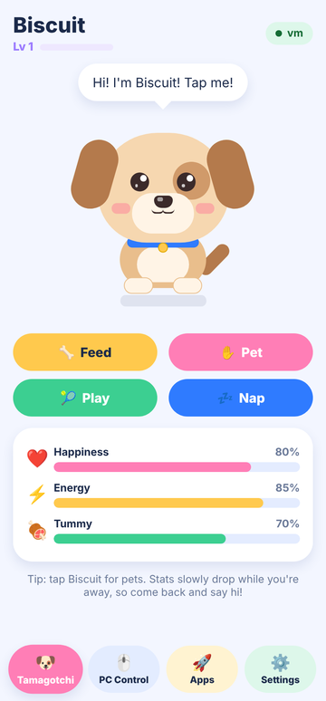
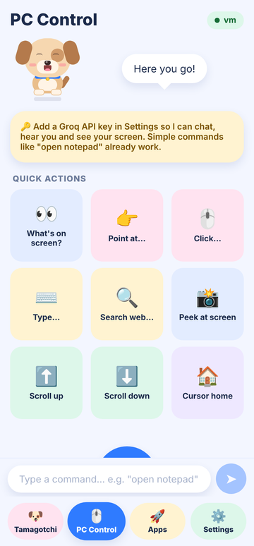
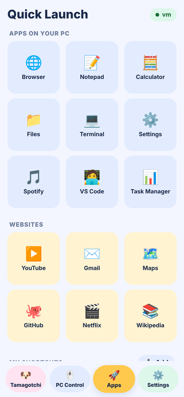
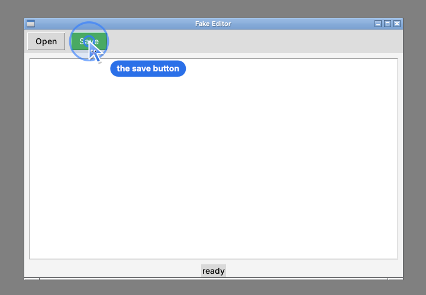
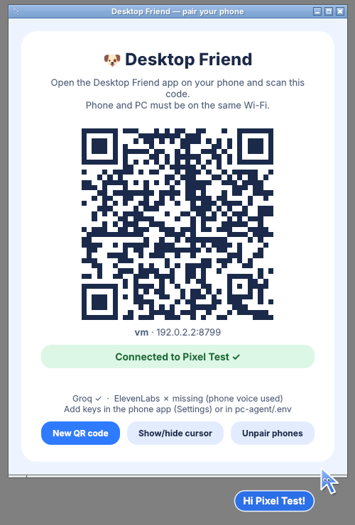

# 🐶 Desktop Friend

A cute AI companion that lives on your **Android phone** and helps out on your **PC**.
The phone pairs with the PC over local Wi-Fi by scanning a QR code. Then you can talk or type to your friend, and it
can **see your screen**, **point at things with its own little blue cursor**, click, scroll, type, open apps and
search the web. It answers out loud with an expressive ElevenLabs voice. When you're not working, it's a
Tamagotchi-style pet you can feed, pet and play with.

| Phone: onboarding | Phone: Tamagotchi | Phone: PC Control | Phone: Quick launch |
|---|---|---|---|
|  |  |  |  |

| PC: the AI's blue cursor pointing at "the save button" | PC: pairing window |
|---|---|
|  |  |

---

## How it works

```
 ┌──────────────── Android phone (Expo / React Native) ────────────────┐
 │  QR scanner · Puppy / custom-photo avatar · Tamagotchi · sounds     │
 │  Push-to-talk (records m4a) · typing box · quick actions · settings │
 └──────────────┬──────────────────────────────────────▲───────────────┘
                │ ws://<pc-ip>:8765/ws  (JSON, token)  │ http GET /audio/<id>.mp3
 ┌──────────────▼──────────────────────────────────────┴───────────────┐
 │                      PC agent (Python, one process)                 │
 │  aiohttp server ─ pairing tokens ─ brain (Groq tool-calling loop)   │
 │      │                 │                      │                     │
 │  Groq Whisper     Groq vision (2-pass     ElevenLabs TTS            │
 │  (voice → text)   grid + zoom locate)     (text → mp3)              │
 │      │                 │                                            │
 │  pyautogui (click / scroll / type / keys) · app launcher · browser  │
 │  PySide6 overlay: transparent, click-through, always-on-top window  │
 │                   with the AI's own blue cursor                     │
 └─────────────────────────────────────────────────────────────────────┘
```

* **The phone never holds API keys.** Groq and ElevenLabs are called only by the PC agent. Keys typed into the
  phone's Settings are sent to the PC over your LAN and saved in `pc-agent/.env`.
* **The blue cursor is separate from your mouse.** It is drawn on a transparent overlay that ignores input. When the
  AI has to *click*, it glides the blue cursor to the target, clicks with the real mouse, and puts your mouse back
  where it was (`DF_RESTORE_MOUSE`). Pointing never touches your mouse.
* **Pointing accuracy:** the screenshot is sent to Groq's vision model with a labelled 0–1000 coordinate grid. A
  second pass zooms into the area around the first guess for a more precise point (`DF_VISION_REFINE`).
* **Works without keys too:** with no Groq key, a rule-based router still handles commands like "open notepad",
  "search the web for cats", "scroll down", "type hello". Without an ElevenLabs key, the phone speaks with its own
  text-to-speech voice.

## Repository layout

```
.
├── pc-agent/                     # PC host agent (Windows / macOS / Linux), Python 3.10+
│   ├── desktop_friend/
│   │   ├── __main__.py           # CLI: python -m desktop_friend [--headless] [--check] [--port] ...
│   │   ├── agent.py              # wires all services together
│   │   ├── server.py             # aiohttp: /ws, /audio/<id>.mp3, /health, local-only QR page
│   │   ├── session.py            # one phone connection: hello/auth, chat, voice, actions, config
│   │   ├── pairing.py            # pairing token, hashed device tokens, QR payload/rendering
│   │   ├── brain.py              # Groq tool-calling loop + persona + fallback
│   │   ├── tools.py              # point_at, click, scroll, type_text, press_keys, open_app, web_search, ...
│   │   ├── vision.py             # screen capture (mss), grid annotation, 2-pass locate, describe
│   │   ├── automation.py         # pyautogui mouse/keyboard, cross-platform app launching
│   │   ├── groq_client.py        # chat / vision / Whisper over Groq's REST API
│   │   ├── tts.py                # ElevenLabs TTS + short-lived audio cache
│   │   ├── websearch.py          # browser search + Groq Compound summary (DuckDuckGo fallback)
│   │   ├── fallback.py           # regex intent router for keyless / offline use
│   │   ├── sounds.py             # synthesized chimes + non-blocking player
│   │   ├── config.py, netinfo.py, protocol.py, ui.py
│   │   └── gui/                  # PySide6: overlay.py (blue cursor), pairing_window.py, app.py, bridge.py
│   ├── tests/                    # 54 pytest tests (server, brain, vision, pairing, GUI off-screen, ...)
│   ├── .env.example              # configuration template (copy to .env)
│   ├── requirements.txt / requirements-dev.txt / pyproject.toml
│   └── start.bat / start.sh      # one-click launchers (create venv, install, run)
├── mobile-app/                   # Android app (Expo SDK 58, React Native 0.88, TypeScript)
│   ├── App.tsx                   # onboarding vs. the four modes
│   ├── src/screens/              # SetupScreen (QR), TamagotchiScreen, ControlScreen, AppsScreen, SettingsScreen
│   ├── src/components/           # Puppy (animated), CustomAvatar, ModeBar, PushToTalk, FloatingEmojis, ...
│   ├── src/lib/                  # connection.ts (WS client), pet.ts, sounds.ts, voice.ts, storage.ts
│   ├── src/state/AppContext.tsx  # app state + protocol handling
│   ├── assets/                   # generated icons and sound effects
│   ├── scripts/                  # generate-sounds.mjs, generate-icons.py
│   └── app.json / eas.json / metro.config.js
├── shared/
│   └── protocol.ts               # the phone⇄PC message contract (source of truth)
├── docs/images/                  # screenshots used in this README
└── .github/workflows/
    ├── android-apk.yml           # builds the APK in the cloud on every push
    └── pc-agent.yml              # PC agent tests on Windows, macOS and Linux
```

<details>
<summary>Initialization commands (how this monorepo was created)</summary>

```bash
# mobile app
npx create-expo-app@latest mobile-app --template blank-typescript
cd mobile-app
npx expo install expo-camera expo-audio expo-image-picker expo-file-system expo-haptics expo-speech \
  expo-build-properties expo-linear-gradient @react-native-async-storage/async-storage \
  react-native-safe-area-context react-native-web react-dom @expo/metro-runtime
npm install -D eslint eslint-config-expo
node scripts/generate-sounds.mjs        # writes assets/sounds/*.wav
python scripts/generate-icons.py        # writes assets/*icon*.png (needs Pillow)
cd ..

# PC agent
cd pc-agent
python -m venv .venv && source .venv/bin/activate      # Windows: .venv\Scripts\activate
pip install -r requirements-dev.txt
cp .env.example .env
```
</details>

---

## 1. Run the PC agent

**Requirements:** Python 3.10 or newer ([python.org](https://www.python.org/downloads/); on Windows tick "Add python.exe to PATH").

### Quick start

```bash
# Windows: double-click pc-agent\start.bat, or from a terminal:
cd pc-agent
start.bat

# macOS / Linux
cd pc-agent
./start.sh
```

The launcher creates a virtual environment, installs dependencies, creates `.env` from `.env.example`, asks for any
missing API keys (input is hidden; press Enter to skip), and starts Desktop Friend. A window with the **pairing QR
code** opens, the QR code is also printed in the terminal, and the little blue cursor appears in the bottom-right
corner of your screen.

### Manual start

```bash
cd pc-agent
python -m venv .venv
source .venv/bin/activate            # Windows: .venv\Scripts\activate
pip install -r requirements.txt
cp .env.example .env                 # Windows: copy .env.example .env, then edit .env
python -m desktop_friend             # GUI + overlay
python -m desktop_friend --headless  # no windows; QR in terminal (servers, SSH, testing)
python -m desktop_friend --check     # verify API keys and model names, then exit
```

Other flags: `--port 9000`, `--new-pairing` (new QR; phones that are already paired stay paired),
`--forget-devices` (unpair all phones), `--env path/to/.env`, `-v` (debug logs).
On the PC, http://localhost:8765/ also shows the pairing QR code (only on the PC itself, never on the LAN).

### API keys

Put your keys in `pc-agent/.env` (or paste them when the launcher asks, or set them later from the phone app):

```ini
GROQ_API_KEY=gsk_...
ELEVENLABS_API_KEY=sk_...
ELEVENLABS_VOICE_ID=cgSgspJ2msm6clMCkdW9
```

> **Why aren't the keys pre-filled in this repo?** This repository is public. Groq and ElevenLabs scan public GitHub
> repos and automatically revoke keys they find, and anyone could use them in the meantime. So keys only ever live in
> your local, git-ignored `.env`. Run `python -m desktop_friend --check` to confirm they work.

| Variable | Default | What it does |
|---|---|---|
| `GROQ_API_KEY` | – | Chat, intent routing, vision, Whisper transcription |
| `ELEVENLABS_API_KEY` | – | Voice replies (otherwise the phone's own TTS is used) |
| `ELEVENLABS_VOICE_ID` | `cgSgspJ2msm6clMCkdW9` (Jessica, playful and warm) | Any voice from your ElevenLabs library |
| `ELEVENLABS_MODEL_ID` | `eleven_flash_v2_5` | Low-latency TTS model |
| `GROQ_CHAT_MODEL` | `openai/gpt-oss-120b` | Tool-calling chat model |
| `GROQ_VISION_MODEL` | `meta-llama/llama-4-scout-17b-16e-instruct` | Screenshot understanding + pointing |
| `GROQ_STT_MODEL` | `whisper-large-v3-turbo` | Voice transcription |
| `GROQ_SEARCH_MODEL` | `groq/compound-mini` | Web-search summaries |
| `DF_PORT` | `8765` | Server port |
| `DF_ALLOW_AUTOMATION` | `true` | Set `false` to allow pointing only (no clicks/typing) |
| `DF_RESTORE_MOUSE` | `true` | Put your mouse back after the AI clicks |
| `DF_VISION_REFINE` | `true` | Second zoomed-in vision pass for accurate pointing |
| `DF_CURSOR_COLOR` | `#2F7BFF` | The AI cursor's colour |
| `DF_PC_SOUNDS` | `true` | Chimes on the PC when pointing / clicking |
| `DF_SEARCH_URL` | Google | Search page opened in your browser (`{query}` placeholder) |

Groq retires models from time to time. If `--check` reports a model as missing, it prints the models your account
can use; put one of them in `.env`.

### OS permissions

* **Windows:** allow Python through the firewall on **private networks** when Windows asks; otherwise the phone
  can't connect.
* **macOS:** System Settings → Privacy & Security → enable **Screen Recording** (for vision) and **Accessibility**
  (for mouse/keyboard) for your terminal app or Python. Restart the agent afterwards.
* **Linux:** use an **X11/Xorg** session (Wayland blocks synthetic input and screen capture for most apps). The
  overlay needs a compositor for transparency (all common desktops have one). If Qt complains about `libEGL`,
  install `libegl1`.

---

## 2. Build the Android APK

Pick whichever is easiest. All three produce the same app.

### Option A: download it from GitHub Actions (no tools needed)

Every push that touches `mobile-app/` runs [`.github/workflows/android-apk.yml`](.github/workflows/android-apk.yml),
which builds a release APK on GitHub's servers.

1. Open the repository on GitHub → **Actions** → **Android APK** → the latest green run.
2. Download the **desktop-friend-apk** artifact (a zip containing `desktop-friend-xxxxxxx.apk`).
3. Copy the `.apk` to your phone and open it (allow "Install unknown apps" for your file manager/browser), or
   `adb install desktop-friend-xxxxxxx.apk`.

You can also start a build by hand: **Actions → Android APK → Run workflow**.

### Option B: Expo EAS cloud build

```bash
npm install -g eas-cli
cd mobile-app
npm ci
eas login                                   # free Expo account
eas build --platform android --profile preview
```

EAS prints a download link / QR code for the `.apk` when it's done (`preview` profile = APK, `production` = Play
Store bundle).

### Option C: build locally with Android Studio / SDK

Requirements: Node.js 20+, **JDK 17**, and the Android SDK (install Android Studio, or set `ANDROID_HOME`).

```bash
cd mobile-app
npm ci
npx expo prebuild --platform android --clean   # generates the native android/ project
cd android
./gradlew assembleRelease                      # Windows: gradlew.bat assembleRelease
# → android/app/build/outputs/apk/release/app-release.apk
adb install app/build/outputs/apk/release/app-release.apk
```

(`npm run apk` does the prebuild + Gradle steps in one go.) The release APK is signed with the debug key, which is
fine for sideloading. For the Play Store, configure your own keystore or use EAS.

### Develop with live reload

```bash
cd mobile-app
npx expo run:android      # dev build on a USB-connected phone or emulator
npm run web               # quick UI preview in the browser (camera/mic features are limited)
```

The app uses native modules (camera, audio recording), so use a development build. Expo Go may not include every
module version.

---

## 3. Pair and play

1. Start the PC agent: the QR window appears.
2. Open **Desktop Friend** on the phone → **Set up Desktop Friend** → allow the camera → scan the QR code.
   (No camera? Tap *Enter the code instead* and paste the `desktopfriend://pair?...` link from the PC terminal.)
3. Both sides switch to companion mode: the PC window says *Connected to <your phone>* and the puppy barks hello.

The phone remembers the PC and reconnects by itself. If the PC's IP address changes, edit it in **Settings → Wi-Fi
connection** or scan a new QR code.

### The four modes (bottom pill buttons)

* **🐶 Tamagotchi:** feed 🦴, pet ✋, play 🎾, nap 💤. Happiness, energy and tummy slowly drop while you're
  away, and your friend levels up with XP. Tap the avatar for pets.
* **🖱️ PC Control:** hold the 🎤 button to talk, or type commands. Quick actions: *What's on screen?*,
  *Point at…*, *Click…*, *Type…*, *Search web…*, *Peek at screen* (live screenshot), scroll, and *Cursor home*.
* **🚀 Apps:** one-tap launchers for PC apps (browser, notepad, calculator, files, terminal, Spotify, VS Code…),
  websites, media keys (play/pause, volume) and shortcuts (save, undo, copy, paste, switch app). Add your own
  shortcuts. Long-press one to remove it.
* **⚙️ Settings:** Groq / ElevenLabs keys and voice ID (saved on the PC), sound effects, vibration, voice options,
  PC chimes, blue-cursor visibility, pet name, **custom avatar photo** (any gallery photo, animated with bounce,
  float, blink and talk pulses), and Wi-Fi connection details.

### Things to say

* "Point at the save button" → the blue cursor glides over and pulses on it
* "Click the play button" / "double-click the Documents folder"
* "What's on my screen?" / "Read me the error message"
* "Search the web for the weather in Paris" → opens the search on the PC and reads back a summary
* "Open Spotify", "Open youtube.com", "Type hello world and press enter", "Press control S", "Scroll down"
* "Open notepad and write a haiku about dogs" (multi-step)

**Safety stop:** slam your real mouse into any screen corner to abort automation (pyautogui fail-safe). Set
`DF_ALLOW_AUTOMATION=false` for point-only mode.

---

## Security model

* The server listens on your LAN. Every WebSocket must start with `hello` carrying either the **pairing token** from
  the QR code or a **device token** issued at pairing. Device tokens are random 256-bit values, stored on the PC only
  as SHA-256 hashes, and can be revoked with *Unpair phones* or `--forget-devices`. *New QR code* rotates the pairing
  token.
* The QR code page (`/` and `/qr.png`) is served only to the PC itself (127.0.0.1).
* Voice clips are served at unguessable, short-lived URLs (`/audio/<96-bit id>.mp3`, deleted after 15 minutes).
* API keys never leave the PC except in calls to Groq / ElevenLabs, are never sent back to the phone, and are never
  logged.
* Traffic is plain `ws://` on your local network (the app enables cleartext traffic for LAN addresses). Don't expose
  the port to the internet.

## Development

```bash
# PC agent
cd pc-agent && pip install -r requirements-dev.txt
QT_QPA_PLATFORM=offscreen python -m pytest -q     # 54 tests, no display needed

# Mobile app
cd mobile-app && npm ci
npx tsc --noEmit && npx eslint .
npx expo export --platform android                # bundles the JS exactly like a release build
```

The protocol contract is [`shared/protocol.ts`](shared/protocol.ts). `pc-agent/tests/test_protocol_sync.py` fails
if the Python side drifts from it.

## Troubleshooting

| Problem | Fix |
|---|---|
| Phone stuck on "Saying hi…" / "Can't reach PC" | Same Wi-Fi? Guest networks and "AP isolation" block device-to-device traffic. Allow Python in the PC firewall (private network). Try the other address shown in the pairing window. |
| "Pairing was refused" | The QR code was rotated or the phone was unpaired. Scan the current QR code. |
| Chat works but no voice | Check `ELEVENLABS_API_KEY` with `--check`. An ElevenLabs API key normally starts with `sk_`. A 20-character value like `21m00Tcm4TlvDq8ikWAM` is a voice ID: put it in `ELEVENLABS_VOICE_ID`. |
| "The Groq model … isn't available" | Run `python -m desktop_friend --check` and pick a listed model in `.env`. |
| Blue cursor points at the wrong place | Keep `DF_VISION_REFINE=true`. Describe the target visually ("the green Save button in the top toolbar"). Multi-monitor: the agent uses the primary screen. |
| Clicks do nothing on macOS | Grant Accessibility (and Screen Recording) permission, then restart the agent. |
| `Could not start the server on port 8765` | Another copy is running. Close it from the tray icon or use `--port`. |
